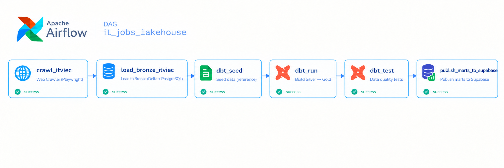

# IT Jobs Lakehouse & ELT Pipeline

Portfolio data engineering project that incrementally collects IT job postings, stores raw batches in Delta Lake and PostgreSQL, transforms them with dbt, and serves analytical marts through a Streamlit dashboard.

**[Open the public Streamlit dashboard](https://itpipetest2-fjugbxbywckpekmf3m4rsb.streamlit.app/)**

The scheduled pipeline crawls **ITviec**. ITviec shows salary only to signed-in
users, so the crawler needs a local authenticated browser session and fails
closed without one. Historical data from TopCV, [Kaggle](https://www.kaggle.com/datasets/bismasajjad/global-ai-job-market-and-salary-trends-2025) and other manually collected sources can remain in the warehouse.

## Architecture




The DAG runs daily at `02:00 Asia/Bangkok`. ITviec is limited to seven pages to target recent jobs instead of
recrawling the site in full.

## Data flow

- **Bronze:** raw crawler payloads in Delta Lake on S3-compatible object storage (MinIO-compatible) and PostgreSQL JSONB.
- **Staging/Silver:** normalized jobs, salary parsing, static Kaggle data and an
  auditable `rejected_jobs` quarantine relation.
- **Gold:** `fact_job_postings`, company/location/date/skill dimensions and the
  job-skill bridge.
- **Marts:** reporting views consumed by the dashboard.

## Analytical marts

The project currently builds 15 analytical marts for:

- market overview and jobs by country;
- salary benchmarks and salary by source;
- jobs by skill, hot skills and yearly skill trends;
- hiring companies;
- Vietnam versus international markets;
- Data Engineer jobs;
- employment type and remote/hybrid/on-site distribution;
- source-level data quality.

## Prerequisites

- Docker Desktop with Docker Compose.
- Python 3.11 and uv for manual commands.
- Google Chrome and an ITviec account to run the scheduled ITviec crawl.
- Free local ports: 5433 (PostgreSQL), 8081 (Adminer), 8180 (Airflow),
  8501 (Streamlit), 9100 and 9101 (object storage). Run `docker compose down`
  in any other copy of this project first, because two stacks cannot share them.

## Quick start

Complete command list for a fresh clone on Windows PowerShell, run from the
repository root.

## 1. Configure. 

```powershell
$env:PYTHONUTF8='1'
uv sync --frozen --group dev
Copy-Item .env.example .env
uv run python -c "from cryptography.fernet import Fernet; print(Fernet.generate_key().decode())"
```

Open .env and then edit .env: replace every change_me value and set AIRFLOW_FERNET_KEY to the generated key.

## 2. Start the stack.

```powershell
docker compose up -d --build --wait
docker compose ps -a
```

## 3.1. Optional: With an ITviec account: create the session, then crawl and load a small batch.

```powershell
uv run python scripts/login_setup_itviec.py
uv run python crawl_itviec.py --max-pages 5
$parquetPath = 'data/raw/itviec/<FILE>.parquet'   # printed as PARQUET_PATH by the crawl
uv run python -m src.load_bronze_crawled --parquet-path $parquetPath --source-name itviec
```

## Or run the whole DAG once from the scheduler.

```powershell
docker compose exec -T airflow-scheduler airflow dags trigger it_jobs_lakehouse
```

Tasks run in this order: `crawl_itviec`, `load_bronze_itviec`, `dbt_seed`,
`dbt_run`, `dbt_test`, `publish_marts_to_supabase`. The last task is `skipped`
when `SUPABASE_DB_URL` is blank.

## 3.2. Optional: Without an ITviec account: load the Kaggle CSV (download it first, see Manual ingestion and dbt).

```powershell
New-Item -ItemType Directory -Force data/raw/kaggle | Out-Null
$csvPath = 'data/raw/kaggle/ai_job_dataset.csv'
uv run python -m src.load_bronze_kaggle --csv-path $csvPath
```

## 4. Build and test Silver, Gold and the marts.

```powershell
uv run --env-file .env dbt seed --project-dir transform_dbt --profiles-dir transform_dbt
uv run --env-file .env dbt run --project-dir transform_dbt --profiles-dir transform_dbt
uv run --env-file .env dbt test --project-dir transform_dbt --profiles-dir transform_dbt
```

Run 3.1, 3.2 or both. Step 4 is required in every case, because the dashboard has
no mart views to read until `dbt run` has built them.

## 5. Open the services.

| Service | Local address | Login |
|---|---|---|
| Streamlit | http://localhost:8501 | None |
| Airflow | http://localhost:8180 | `AIRFLOW_ADMIN_USER` / `AIRFLOW_ADMIN_PASSWORD` from `.env` |
| Adminer | http://localhost:8081 | `POSTGRES_USER` / `POSTGRES_PASSWORD` from `.env` (Server: `postgres`, DB: `POSTGRES_DB`) |
| Object storage console | http://localhost:9101 | `MINIO_ROOT_USER` / `MINIO_ROOT_PASSWORD` from `.env` |

## Publish Gold marts to Supabase

Supabase is a derived serving layer for the public dashboard, not the pipeline source of truth. Set `SUPABASE_DB_URL` in `.env` file. After `dbt_test` succeeds, 
the final Airflow task publishes all 15 curated Gold marts in one database transaction and verifies every destination row count and column type inside it (a failed check rolls back, so Supabase keeps the previous
snapshot). If the variable is blank, the task is marked `skipped`, so a fresh local clone does not depend on Supabase.

## Project Structure

```text
IT_jobs_pipeline/
├── .github/
│   └── workflows/
│       └── ci.yml                    # CI: lint, dbt tests, dashboard smoke test
│
├── .env.example                      # Local configuration template (copy to .env)
│
├── crawl_itviec.py                   # CLI entry point for the ITviec crawl
│
├── containers/
│   ├── airflow/                      # Airflow image/configuration
│   ├── dashboard/                    # Streamlit dashboard container
│   └── postgres/                     # PostgreSQL initialization
│
├── dags/
│   ├── it_jobs_lakehouse_dag.py       # Airflow orchestration: crawl → Bronze → dbt → publish
│   └── telegram_alerts.py            # Retry/failure callback -> Telegram
│
├── dashboard/
│   ├── app.py                        # Streamlit dashboard (pages, charts, data-dependent insights)
│   ├── queries.py                    # SQL for the dashboard pages
│   └── smoke_test.py                 # Renders all 10 pages (used by CI)
│
├── src/
│   ├── config.py                     # Environment-based configuration
│   ├── crawl_runner.py               # Crawl orchestration and source dispatch
│   ├── incremental_state.py          # Incremental crawl state / job ID tracking
│   ├── it_job_filter.py              # Conservative IT-scope classification
│   ├── load_bronze_crawled.py        # Validate + write crawled data to Bronze
│   ├── load_bronze_kaggle.py         # Load the Kaggle CSV into Bronze
│   │
│   ├── output/
│   │   └── parquet_writer.py         # Write crawl batches to Parquet
│   │
│   ├── pages/
│   │   ├── base_page.py              # Shared page-object helpers (safe_text, retries)
│   │   ├── itviec_job_list_page.py   # ITviec job-list page interaction
│   │   └── itviec_job_detail_page.py # ITviec job-detail page interaction
│   │
│   ├── schemas/
│   │   └── raw_job.py                # Pydantic schema for raw job postings
│   │
│   └── scrapers/
│       ├── base.py                   # Shared scraper lifecycle/error handling
│       ├── errors.py                 # Crawl error types
│       ├── incremental.py            # Incremental scraping logic
│       ├── itviec_scraper.py         # ITviec-specific scraper
│       └── normalization.py          # Raw field normalization
│
├── transform_dbt/
│   ├── models/
│   │   ├── staging/                  # Source-level normalization
│   │   ├── silver/                   # Conformed/cleaned job data
│   │   ├── gold/                     # Dimensional model + bridges
│   │   └── marts/                    # 15 analytical marts served to the dashboard
│   │
│   ├── macros/
│   │   └── materializations/         # Custom Gold merge/upsert materialization
│   │
│   ├── seeds/
│   │   ├── skill_aliases.csv         # Canonical skill mapping
│   │   └── fx_rates.csv              # Currency conversion rates
│   │
│   └── tests/                        # dbt data-quality tests
│
├── scripts/
│   ├── check_secrets.py              # Secret scan (used by CI)
│   ├── login_setup_itviec.py         # Create the ITviec browser session
│   ├── publish_marts_to_supabase.py  # Publish Gold marts to Supabase
│   └── cloud/                        # Cloud/GCS-related utilities
│
├── demo/
│   └── ...                            # Demo assets
│
├── storage_state/
│   └── ...                            # Local authenticated browser session state
│
├── docker-compose.yml                # Local multi-container environment
├── pyproject.toml / uv.lock          # Pinned Python dependencies
└── README.md                         # Project documentation
```


## Limitations

- ITviec sessions expire and require manual refresh; until then the scheduled
  crawl fails closed and alerts through Telegram.
- The daily crawl reads seven ITviec pages. After an outage longer than a few
  days, recover the backlog with a one-off crawl that raises both `--max-pages`
  and `--known-pages-stop`.