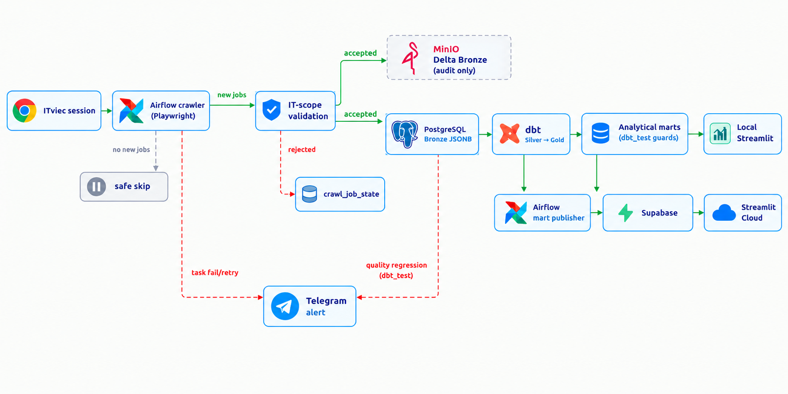

# IT Jobs Lakehouse & ELT Pipeline

An end-to-end ELT pipeline that incrementally collects IT job postings from ITviec, lands them in a Bronze layer (Delta Lake + PostgreSQL), models them with dbt through a Medallion architecture (Bronze, Silver, Gold), and serves 15 analytical marts through a Streamlit dashboard. Airflow runs it daily; the whole stack starts with one docker compose up.

**[Open the public Streamlit dashboard](https://it-jobs-lakehouse-8aclva3exbqkxpt486n6e6.streamlit.app/)**

## What it demonstrates

- **Incremental, fail-closed ingestion.** Known job IDs are skipped, the crawl stops after three consecutive pages with nothing new (hard cap of seven pages), failing jobs are quarantined after three attempts, and the run fails instead of writing partial or salary-less data when the session or page structure is broken.
- **Idempotent dual-write Bronze.** Each batch is written to Delta Lake (`MERGE` on the natural key) and then to PostgreSQL JSONB (`INSERT ... ON CONFLICT DO UPDATE`); the crawl state is recorded last, so an Airflow retry converges to the same result.
- **Medallion modelling with dbt.** Staging, Silver, Gold star schema (fact, dimensions, job-skill bridge) and 15 marts, with a custom `gold_merge` materialization that issues a `MERGE` into pre-created, partitioned Gold tables.
- **Layered data quality.** 223 dbt data tests plus four pipeline guards (freshness, volume, salary coverage, skills coverage) that stop the DAG before anything is published. Jobs whose salary cannot be parsed are kept out of Silver and exposed through the auditable `rejected_jobs` view.
- **Atomic publishing.** All 15 marts go to Supabase in a single transaction, with row counts and column types verified before commit; a failed check rolls back and the previous snapshot stays.
- **Reproducible and maintained.** Locked dependencies (`uv.lock`), digest-pinned images, CI with a secret scan, Ruff, dbt tests and a 10-page dashboard smoke test, plus Dependabot and a weekly upstream image check.

## Architecture




The DAG runs daily at `02:00 Asia/Bangkok`. ITviec is limited to seven pages to target recent jobs instead of recrawling the site in full.

### Data flow

| Layer                | What it holds                                                                                                                                   |
| -------------------- | ----------------------------------------------------------------------------------------------------------------------------------------------- |
| **Bronze**           | Raw crawler payloads in Delta Lake on S3-compatible object storage and in PostgreSQL (`payload` JSONB); static Kaggle data; per-job crawl state |
| **Staging / Silver** | Normalized jobs, salary parsing to a yearly USD range, company/location/skill normalization through seeds, and the `rejected_jobs` view         |
| **Gold**             | `fact_job_postings`, company/location/date/skill dimensions and the job-skill bridge                                                            |
| **Marts**            | 15 reporting views (published to Supabase as tables) consumed by the dashboard                                                                  |

## Analytical marts

The project currently builds 15 analytical marts for:

- market overview and jobs by country;
- salary benchmarks and salary by source;
- jobs by skill, hot skills and yearly skill trends;
- hiring companies;
- Vietnam versus international markets;
- Data Engineer jobs;
- employment type and remote/hybrid/on-site distribution;
- source-level data quality.

### Sources

The scheduled pipeline crawls **ITviec** only. ITviec shows salary only to signed-in users, so the crawler needs a local authenticated browser session and fails closed without one. 
Historical [Kaggle](https://www.kaggle.com/datasets/bismasajjad/global-ai-job-market-and-salary-trends-2025) data is loaded manually.


## Prerequisites

- Docker Desktop with Docker Compose.
- Python 3.11 and uv for manual commands.
- Google Chrome and an ITviec account to run the scheduled ITviec crawl.
- Free local ports: 5433 (PostgreSQL), 8081 (Adminer), 8180 (Airflow),
  8501 (Streamlit), 9100 and 9101 (object storage). Run `docker compose down`
  in any other copy of this project first, because two stacks cannot share them.

## Quick start

Complete command list for a fresh clone on Windows PowerShell, run from the
repository root.

## 1. Configure. 

```powershell
$env:PYTHONUTF8='1'
uv sync --frozen --group dev
Copy-Item .env.example .env
uv run python -c "from cryptography.fernet import Fernet; print(Fernet.generate_key().decode())"
```

Open .env and then edit .env: replace every change_me value and set AIRFLOW_FERNET_KEY to the generated key.

## 2. Start the stack.

```powershell
docker compose up -d --build --wait
docker compose ps -a
```

## 3.1. Optional: With an ITviec account: create the browser session, then crawl and load a small batch.

```powershell
uv run python scripts/login_setup_itviec.py
uv run python crawl_itviec.py --max-pages 5
$parquetPath = 'data/raw/itviec/<FILE>.parquet'
uv run python -m src.load_bronze_crawled --parquet-path $parquetPath --source-name itviec
```

## Or run the whole DAG once from the scheduler.

```powershell
docker compose exec -T airflow-scheduler airflow dags trigger it_jobs_lakehouse
```

Tasks run in this order: `crawl_itviec`, `load_bronze_itviec`, `dbt_seed`,
`dbt_run`, `dbt_test`, `publish_marts_to_supabase`. The last task is `skipped`
when `SUPABASE_DB_URL` is blank.

## 3.2. Optional: Without an ITviec account: load the Kaggle CSV (download it first to `data/raw/kaggle/ai_job_dataset.csv`).

```powershell
New-Item -ItemType Directory -Force data/raw/kaggle | Out-Null
$csvPath = 'data/raw/kaggle/ai_job_dataset.csv'
uv run python -m src.load_bronze_kaggle --csv-path $csvPath
```

## 4. Build and test Silver, Gold and the marts.

```powershell
uv run --env-file .env dbt seed --project-dir transform_dbt --profiles-dir transform_dbt
uv run --env-file .env dbt run --project-dir transform_dbt --profiles-dir transform_dbt
uv run --env-file .env dbt test --project-dir transform_dbt --profiles-dir transform_dbt
```

Run 3.1, 3.2 or both. Step 4 is required in every case, because the dashboard has
no mart views to read until `dbt run` has built them.

## 5. Open the services.

| Service | Local address | Login |
|---|---|---|
| Streamlit | http://localhost:8501 | None |
| Airflow | http://localhost:8180 | `AIRFLOW_ADMIN_USER` / `AIRFLOW_ADMIN_PASSWORD` from `.env` |
| Adminer | http://localhost:8081 | `POSTGRES_USER` / `POSTGRES_PASSWORD` from `.env` (Server: `postgres`, DB: `POSTGRES_DB`) |
| Object storage console | http://localhost:9101 | `MINIO_ROOT_USER` / `MINIO_ROOT_PASSWORD` from `.env` |

To stop the stack, run `docker compose down`. Adding `-v` also deletes the PostgreSQL, object-storage and Airflow-log volumes.

## Publish Gold marts to Supabase

Supabase is a derived serving layer for the public dashboard, not the pipeline source of truth. Set `SUPABASE_DB_URL` in `.env` file. After `dbt_test` succeeds, 
the final Airflow task publishes all 15 curated Gold marts in one database transaction and verifies every destination row count and column type inside it (a failed check rolls back, so Supabase keeps the previous
snapshot). If the variable is blank, the task is marked `skipped`, so a fresh local clone does not depend on Supabase.

## Project Structure

```text
.
├── .github/
│   ├── dependabot.yml
│   └── workflows/
│       ├── ci.yml                    # lint, dbt tests, dashboard smoke test
│       └── upstream-check.yml        # weekly image availability check
├── containers/
│   ├── airflow/                      # Airflow image
│   ├── dashboard/                    # Streamlit image
│   └── postgres/                     # PostgreSQL initialization (Gold DDL)
├── dags/
│   ├── it_jobs_lakehouse_dag.py      # crawl → Bronze → dbt → publish
│   └── telegram_alerts.py            # failure callback → Telegram
├── dashboard/
│   ├── app.py                        # Streamlit pages, charts, data-driven insights
│   ├── queries.py                    # SQL for the dashboard pages
│   └── smoke_test.py                 # renders all 10 pages (used by CI)
├── src/
│   ├── config.py                     # environment-based configuration
│   ├── crawl_runner.py               # crawl orchestration
│   ├── incremental_state.py          # per-job crawl state (loaded/rejected/failed/quarantined)
│   ├── it_job_filter.py              # IT-scope classification
│   ├── load_bronze_crawled.py        # validate + dual-write crawled data to Bronze
│   ├── load_bronze_kaggle.py         # load the Kaggle CSV into Bronze
│   ├── output/                       # Parquet writer
│   ├── pages/                        # ITviec page objects
│   ├── schemas/                      # Pydantic schema for raw jobs
│   └── scrapers/                     # scraper lifecycle, incremental logic, errors
├── transform_dbt/
│   ├── models/                       # staging, silver, gold, marts (26 models)
│   ├── macros/                       # salary parser, company key, gold_merge, stale-row cleanup
│   ├── seeds/                        # fx_rates, skill_aliases, company_aliases, vn_location_aliases
│   └── tests/                        # singular data-quality tests and pipeline guards
├── scripts/
│   ├── check_secrets.py              # secret scan (used by CI)
│   ├── login_setup_itviec.py         # create the ITviec browser session
│   ├── publish_marts_to_supabase.py  # publish Gold marts to Supabase
│   └── cloud/                        # optional GCS utilities (not part of the DAG)
├── demo/                             # architecture diagrams
├── storage_state/                    # local ITviec session (git-ignored)
├── crawl_itviec.py                   # CLI entry point for the ITviec crawl
├── docker-compose.yml
├── pyproject.toml / uv.lock
└── LICENSE
```

## Limitations

- ITviec sessions expire and require manual refresh; until then the scheduled
  crawl fails closed and alerts through Telegram.
- The daily crawl reads seven ITviec pages. After an outage longer than a few
  days, recover the backlog with a one-off crawl that raises both `--max-pages`
  and `--known-pages-stop`.

## License

[MIT](LICENSE)